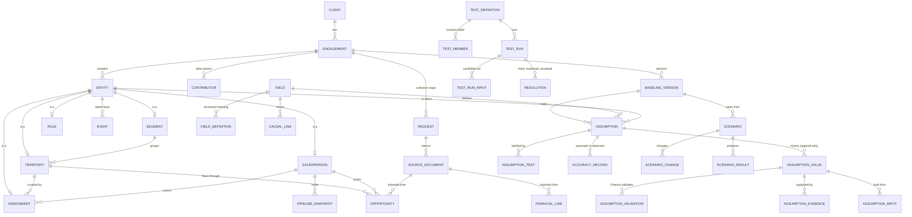

# Database Schema: the Assumption Ledger

Status: **V1 schema, 2026-10-24.** Implements [DATA_MODEL_REQUIREMENTS.md](DATA_MODEL_REQUIREMENTS.md). Code: `src/sales_capacity_model/db/schema.sql` (tables, triggers, views) and `seed.sql` (collection steps, field catalog, structural assumptions, tests, causal links). Tested in `tests/test_schema.py` with the as-is sample data.

```python
from sales_capacity_model.db import create
con = create("engagement.db")   # schema + reference data, SQLite
```

© 2000–2026 Growth Enablement. All rights reserved.

## Design in one paragraph

Raw facts (CRM opportunities, pipeline snapshots, ledger lines, roster, territory plan, events) are stored as **observations**. Everything the model reasons with is an **assumption**: one field, about one entity, in one scope, in one baseline version. Each assumption keeps every **value** ever asserted for it, append-only, with its basis, owner, range, lineage and evidence. **Tests** record which values they used, so a failure points to its candidate set. **Scenarios** change assumptions in a copy and never write back. The model's own structure is data too: the **field catalog** tags every field with its element type and Meadows leverage point, and **causal links** record how fields drive each other.

## Entity relationships



## Tables by layer

| Layer | Tables | Holds |
|---|---|---|
| 1. Tenancy, scope, versions | `client`, `engagement`, `contributor`, `baseline_version` | Scope, period, currency, revenue basis; data owners by role; draft → working → in review → signed |
| 2. Collection | `collection_step`, `request`, `source_document` | The 11-step sequence, requests sent to owners, uploaded files with content hashes |
| 3. Meaning | `field`, `field_definition`, `causal_link` | What can be known, its unit, level, element type, leverage point; versioned definitions with report recipes; how fields drive each other |
| 4. System entities | `entity` (supertype), `territory`, `salesperson`, `assignment`, `segment`, `rule`, `event` | Territory design and staffing as separate entities joined only by assignment; dated vacancy stages, hires, departures |
| 5. Observations | `opportunity`, `pipeline_snapshot`, `financial_line` | Raw imports kept so estimators can recompute |
| 6. Assumption ledger | `assumption`, `assumption_value`, `assumption_input`, `assumption_evidence`, `assumption_validation`, `assumption_test` | Every claim, its history, lineage, evidence, Finance validation and falsification test |
| 7. Tests | `test_definition`, `test_member`, `engagement_test_config`, `test_run`, `test_run_input`, `resolution` | Test library, which fields each test involves, per-engagement tolerances, every run with the exact values used, and how failures were resolved |
| 8. Track record | `accuracy_record` | Assumed vs observed per period |
| 9. Scenarios | `scenario`, `scenario_change`, `scenario_result` | Changes to a baseline's assumptions (including scenario-only entities), cached results with engine version |

## Rules enforced by the database

| Rule | How |
|---|---|
| History is never overwritten | Triggers block UPDATE and DELETE on values, events, test runs, resolutions, accuracy records |
| Signed baselines are frozen | Triggers block changes to a signed baseline and new assumptions or values in it |
| Every value declares its basis | `basis` is required: validated actual, calculated estimate, reference value, judgment |
| Reference values name their context | CHECK: `reference_context` required for reference values |
| Estimates and judgments carry a range | CHECK: low and high required for reference values and judgments; value must sit inside the range |
| Leadership beliefs are captured before data | Trigger: a sealed belief must be a judgment and the first value for its slot |
| Only Finance validates | Trigger on `assumption_validation` checks the contributor's role |
| Salespeople are pseudonymous | `salesperson` has a pseudonym (hashed HR ID with a per-engagement salt) and no name column; contributors and salespeople are separate tables |
| Open territories are visible | A territory with no current assignment is open; `v_territory_assignment_share` |

## Views for the data module's outputs

| View | Answers |
|---|---|
| `v_current_value` | The current value of every assumption, with basis and whether Finance validated it |
| `v_perception_gap` | Sealed leadership belief vs current evidence-based value, per field and entity |
| `v_territory_assignment_share` | Which salesperson covers which territory, with share of time; open territories |
| `v_vacancy_stages` | Dates of each stage of each vacancy, for approval-latency cost |
| `v_candidate_set` | For every unresolved failed test, the values that could be wrong |
| `v_confidence_profile` | Share of current values by basis, per baseline |

## Notes

- **V1 is SQLite**; the SQL is standard enough to move to PostgreSQL with type changes (`TEXT` dates to `DATE`, `REAL` to `NUMERIC`), adding row-level security per client.
- **Evidence files** live outside the database (file storage), referenced by `source_document.content_hash`.
- **Derived values are not stored as truth:** calculated estimates are stored as assumption values with their inputs, so they can always be recomputed and audited; scenario results are a cache keyed by engine version.
- **Scenario-only structure:** a scenario can add a territory or role as an entity with `scenario_id` set, so structural what-ifs never touch the baseline.
